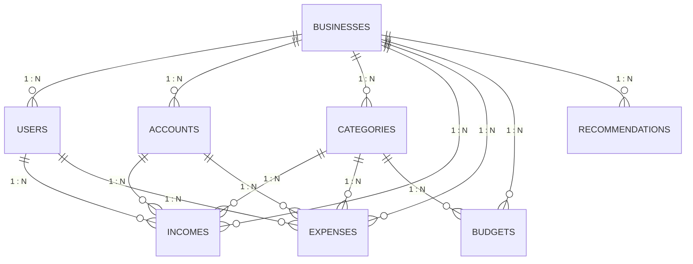

# PRD: Aplikasi Pencatatan Keuangan untuk Bisnis UMKM
Status: **DRAF v0.2**, untuk didiskusikan

## 1. Latar belakang
Banyak UMKM mencampur uang usaha dengan uang pribadi dan tidak mencatat rutin, sehingga tidak tahu
apakah usahanya untung atau rugi.

## 2. Tujuan
- Pemilik usaha mencatat pemasukan dan pengeluaran dengan cepat.
- Laba kotor dan laba bersih per bulan terlihat tanpa menghitung manual.
- Pemilik mendapat rekomendasi yang bisa ditindaklanjuti.

## 3. Pengguna
| Peran | Kebutuhan |
|---|---|
| Pemilik UMKM | Daftar sendiri, melihat laba, mengatur anggaran |
| Staf (fase 2) | Mencatat transaksi |

## 4. Ruang lingkup MVP
| # | Fitur | Keterangan |
|---|---|---|
| F1 | Halaman utama | Penjelasan aplikasi, tombol Daftar dan Masuk |
| F2 | Daftar & login | Terbuka untuk semua UMKM; data tiap usaha terpisah |
| F3 | Pemasukan | Penjualan, pendapatan lain, modal |
| F4 | Pengeluaran | HPP (bahan/barang dagangan), operasional, prive |
| F5 | Anggaran bulanan | Batas per kategori, peringatan di 80% dan di atas 100% |
| F6 | Laporan laba rugi | Per bulan, ekspor CSV |
| F7 | Rekomendasi | Saran otomatis berbasis aturan |
| F8 | Dasbor | Saldo kas, laba bulan ini, tren 3 bulan |

**Di luar lingkup:** hutang/piutang, stok, pajak, koneksi bank, akuntansi berpasangan.

## 5. Aturan bisnis
- Laba kotor = penjualan - HPP.
- Laba bersih = laba kotor - beban operasional + pendapatan lain.
- Modal dan prive mengubah saldo kas, tetapi tidak dihitung dalam laba.
- Penyederhanaan: HPP dicatat saat barang/bahan dibayar, bukan saat terjual.
- Pendaftaran membuat satu usaha dan satu pemilik dalam satu transaksi database. Email unik.
- Semua query difilter `business_id` milik pengguna yang login.

## 6. Aturan rekomendasi
| Kondisi | Saran |
|---|---|
| Laba bersih negatif | Periksa pengeluaran terbesar |
| Margin laba bersih di bawah 10% | Tinjau harga jual dan HPP |
| Anggaran terpakai lebih dari 100% / minimal 80% | Tahan belanja kategori itu |
| Beban operasional naik lebih dari 20% dari bulan lalu | Cek kategori yang naik |
| Prive lebih besar dari laba bersih | Kurangi pengambilan pribadi |

Ambang di atas adalah usulan awal. Rekomendasi bukan nasihat keuangan profesional.

## 7. Kebutuhan non-fungsional
Mobile-first, password di-hash, batasi percobaan login, validasi input di server.

## 8. Relasi antar tabel (ERD)
Skema lengkap ada di `db/schema.sql`, gambar di `docs/erd-one-to-many.png`.

`incomes` = pemasukan, `expenses` = pengeluaran, `budgets` = anggaran, `recommendations` = rekomendasi.
Laba rugi (`v_laba_rugi`) dan saldo (`v_saldo_akun`) dihitung lewat view, tidak disimpan sebagai tabel.

## 9. Pertanyaan untuk diskusi
1. Perlu hutang/piutang di fase 2?
2. Jenis UMKM target pertama?
