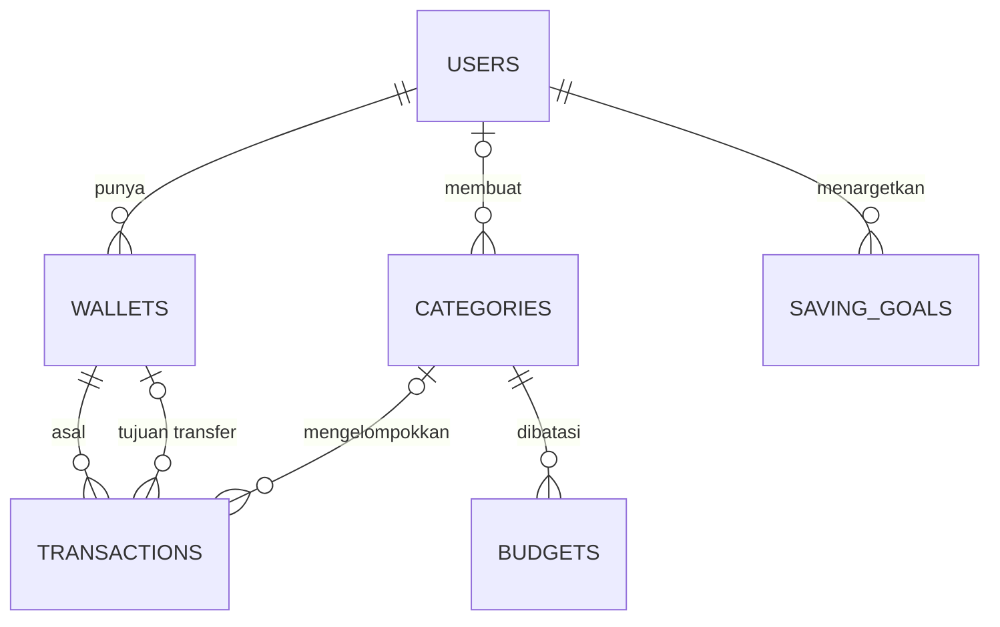

# PRD: Pencatat Keuangan Pribadi
Status: **DRAF v0.1**, untuk didiskusikan

## 1. Latar belakang
Banyak orang tidak tahu uangnya habis untuk apa karena pencatatan manual cepat ditinggalkan.

## 2. Tujuan
- Mencatat pemasukan atau pengeluaran dalam waktu kurang dari 10 detik.
- Saldo per dompet dan ringkasan bulanan terlihat jelas.
- Pengguna tahu saat anggaran hampir habis.

## 3. Pengguna
Mahasiswa, pekerja, dan siapa pun yang ingin mengatur uang pribadi.

## 4. Ruang lingkup MVP
| # | Fitur | Keterangan |
|---|---|---|
| F1 | Akun | Daftar, login, hapus akun |
| F2 | Dompet | Tunai, rekening, e-wallet (saldo diisi manual) |
| F3 | Transaksi | Pemasukan, pengeluaran, transfer antar dompet |
| F4 | Kategori | Kategori bawaan dan buatan sendiri |
| F5 | Anggaran bulanan | Batas per kategori, peringatan di 80% dan 100% |
| F6 | Target tabungan | Nominal target, tenggat, progres |
| F7 | Dasbor & laporan | Grafik per kategori, tren 6 bulan, ekspor CSV |

**Di luar lingkup:** koneksi ke bank/e-wallet, paylater dan gamifikasi (ada di proyek tracker paylater),
saran investasi.

## 5. Aturan bisnis
- Saldo dompet = saldo awal + pemasukan - pengeluaran, ditambah/dikurangi transfer.
- Transfer tidak dihitung sebagai pemasukan atau pengeluaran.
- Uang disimpan sebagai bilangan bulat rupiah.

## 6. Kebutuhan non-fungsional
Mobile-first, password di-hash, setiap pengguna hanya bisa melihat datanya sendiri.

## 7. Relasi antar tabel (ERD)
Skema lengkap ada di `db/schema.sql`.

## 8. Metrik keberhasilan
- Pengguna uji mencatat minimal 4 hari per minggu selama 2 minggu.

## 9. Pertanyaan untuk diskusi
1. Web saja, atau perlu bisa dipasang di HP (PWA)?
2. Perlu mode offline?
